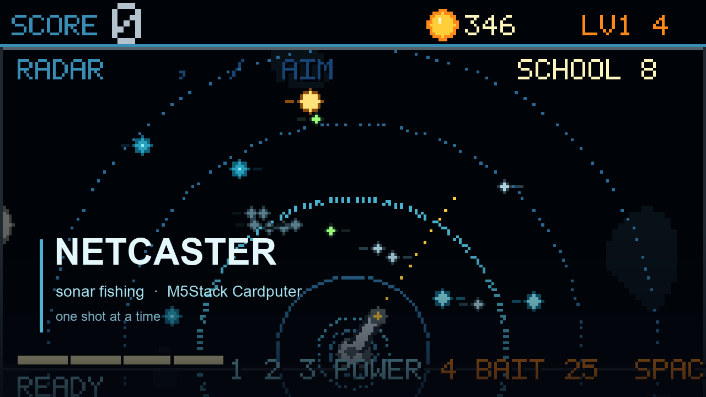
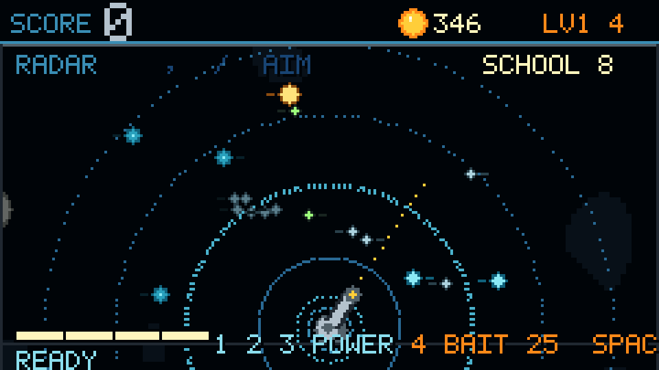
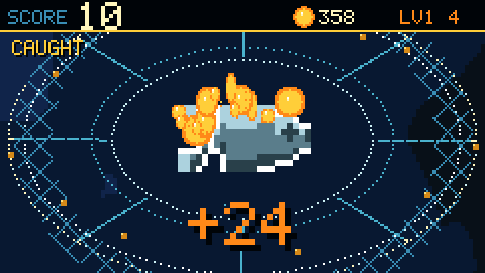
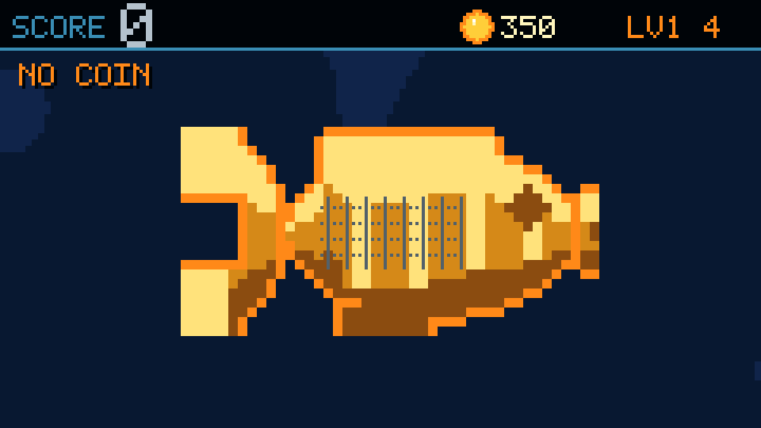
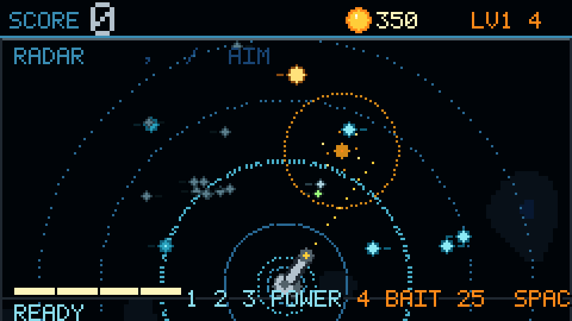
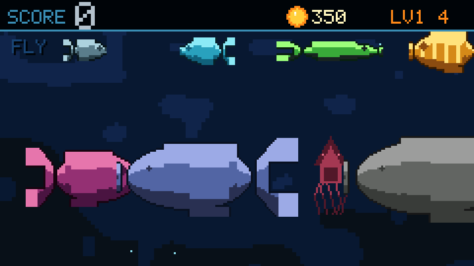
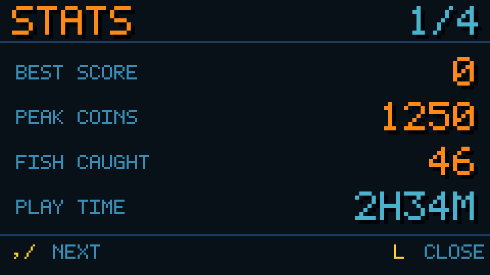

# NETCASTER



> An arcade-style **sonar fishing** game for the M5Stack Cardputer.
> 240×135, no PSRAM, one shot at a time — you watch the radar, aim the cannon, and snipe.

把 Cardputer 变成一台声呐捕鱼机。屏幕上是一片抽象的海：炮台在底下，鱼是雷达上的回波点。
**不是扫射捕鱼，是一竿一竿的狙击。**

---

## 这是什么样的游戏

- **雷达视图**：整片海缩成 240×135 的点阵，鱼是带航向的小点，大小代表身价。炮口只有一条 47px 的短虚线，靠 `,` `/` 或 IMU 调角。
- **一发定生死**：开炮后镜头推进到命中点，3× 特写慢动作收网（1.3s）。抓住、挣脱、落空是三种完全不同的演出。
- **三级炮台**：1 号只够糊小鱼，2 号是主力营生，3 号贵但能穿透——**只在有大鱼时才划算**。开满 3 号乱打反而亏。
- **打窝（唯一道具）**：撒一把饵，附近的鱼会游过来。但**打窝不等于上鱼**——窝只负责把鱼叫来，开炮还是你自己的事。
- **潮汐**：每 100~170 秒来一次，鱼价 ×1.5、鱼群变密，音乐也从大调翻成小调。
- **鱼有脾气**：小鱼会装死，怪鱼会盯着你，鲨鱼会吃掉身边的小鱼，鱿鱼被盯久了会喷你一脸墨。

## 看一眼

| 雷达：整片海缩成回波点 | 捕获：3× 慢动作收网 |
|---|---|
|  |  |
| **挣脱**：网在抖，鱼在挣 | **打窝**：饵沉下去，鱼才来 |
|  |  |

| 鱼的点阵 | 鱼获图鉴 |
|---|---|
|  |  |

> 以上全部是程序在 PC 上渲染出来的真实帧（`sim/build.sh` 导出），不是手绘示意图。

## 硬件

- **M5Stack Cardputer ADV**（ESP32-S3FN8，8MB flash，**无 PSRAM**）
- 屏幕 240×135，键盘 Cherry MX + TCA8418，ES8311 + 1W 喇叭

## 按键

| 键 | 作用 |
|---|---|
| `,` `a` / `/` `d` | 炮口左 / 右 |
| `空格` | 发射 |
| `1` `2` `3` | 切炮台等级 |
| `4` | 打窝（25 金币） |
| `i` | 切换 IMU / 按键瞄准 |
| `m` | 静音 |
| `l` | 鱼获图鉴（4 页） |
| `h` | 帮助 |

## 构建

```bash
# PlatformIO
pio run -e cardputer                                   # 编译
pio run -e cardputer -t upload --upload-port /dev/cu.usbmodem101
```

⚠️ `platformio.ini` 绝不能启用 `psram` —— 这块板没有。

### 在电脑上跑（不需要硬件）

```bash
cd sim && ./build.sh
```

会编译一份平台无关的构建，跑完整回归测试，并导出 PPM/PNG 截图。`sim/` 里是纯 C++，不依赖 M5 库。

## 设计文档

完整规格、数值、以及**踩过的坑和已否决的方案**都在 [SPEC.md](SPEC.md)。里面记着为什么某些"更好地"的做法不行——比如多段血、辅助瞄准、渔网道具、随机节奏 BGM。

## 商店

M5Burner → 搜索 `NETCASTER`（Cardputer ADV / Games）

## License

MIT
